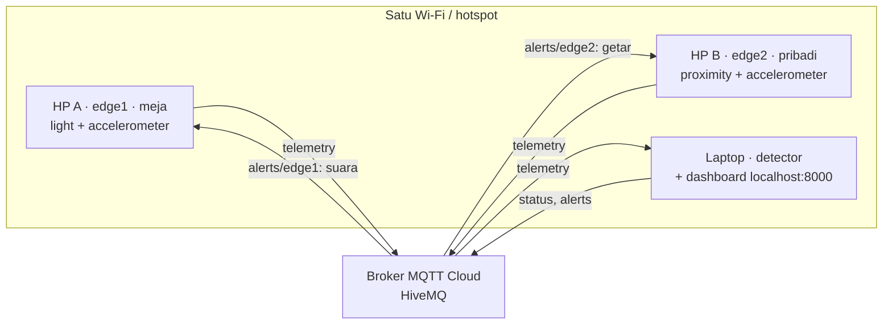

# FocusDesk IoT

Pemantau fokus belajar berbasis IoT: **2 HP Android sebagai edge**, **3 sensor** (cahaya, proximity, accelerometer), **4 data processing**, algoritma **skor fokus + Pomodoro**, komunikasi **MQTT Cloud (HiveMQ)**, dan **dashboard di laptop**.

## Masalah & ide

Mahasiswa sering merasa sudah belajar berjam-jam, padahal sebagian waktunya habis untuk mengecek HP, melamun, atau belajar di cahaya yang kurang. FocusDesk mengukur fokus secara objektif:

- **HP A (meja)** diletakkan di meja dengan layar menghadap ke atas. HP ini mengukur cahaya meja dan getaran meja saat kamu menulis atau mengetik.
- **HP B (pribadi)** ditelungkupkan di meja selama sesi. Kalau HP ini diangkat, HP B bergetar dan menegur.
- **Laptop** menggabungkan data kedua HP menjadi skor fokus 0–100, menjalankan timer Pomodoro, dan menampilkan dashboard.

## Cara kerja



| Kondisi saat sesi fokus | Status | Aksi |
|---|---|---|
| HP B tertelungkup, meja aktif, cahaya cukup | `FOKUS` | – |
| HP B diangkat | `TERDISTRAKSI` | HP B bergetar dan muncul notifikasi |
| Cahaya < 300 lux selama 30 detik | `CAHAYA_KURANG` | HP A bersuara "Nyalakan lampu meja" |
| Cahaya > 1500 lux selama 30 detik | `CAHAYA_SILAU` | HP A bersuara |
| Meja diam selama 3 menit | `MELAMUN` | HP A bersuara "Ayo lanjut belajar" |
| Timer fokus habis | `ISTIRAHAT` | HP A bersuara, HP B bergetar |

Detail rumus dan algoritma: [docs/ARCHITECTURE.md](docs/ARCHITECTURE.md).

## 1. Laptop: detector & dashboard

Pastikan sudah ada **Python 3.10+** dan internet.

```bash
python -m pip install -r requirements.txt
cp .env.example .env
```

*Di Windows PowerShell, gunakan `Copy-Item .env.example .env`.*

Ganti `PROJECT_ID` di `.env` menjadi nama kelompok yang unik, misalnya `focusdesk_kelompok_07`. Default memakai broker publik HiveMQ (tanpa akun, **jangan kirim data rahasia**).

```bash
python detector.py
```

Buka **http://localhost:8000** di laptop.

## 2. HP A dan HP B: Termux

Di kedua HP: pasang Termux + Termux:API dari F-Droid, salin repo ini, install dependensi, dan samakan `PROJECT_ID` dengan laptop. Panduan lengkap: [docs/ANDROID.md](docs/ANDROID.md).

**HP A (meja, layar menghadap ke atas):**
```bash
python hp_meja.py
```

**HP B (pribadi, ditelungkupkan):**
```bash
python hp_pribadi.py
```

### HP B memakai iPhone (tanpa Termux)

iPhone tidak bisa memakai Termux, jadi HP B dijalankan lewat Safari:

**https://uoeye670-web.github.io/focusdesk-iot/web/hp-pribadi.html**

Halaman ini membaca **accelerometer + gyroscope** (proximity tidak tersedia di browser), mengolahnya dengan rumus yang sama, lalu mengirim telemetry `edge2` lewat MQTT over WebSocket. Saat ada alert, layar berubah merah dan berbunyi (iPhone tidak bisa digetarkan dari browser). Isi PROJECT_ID, kalibrasi dengan HP terlentang, tekan **Mulai**, lalu telungkupkan HP. Atur **Auto-Lock: Never** supaya layar tidak terkunci.

HP A tetap harus Android karena butuh sensor cahaya.

## 3. Coba sistemnya

1. Di dashboard, tekan **START**. Timer mulai berjalan.
2. Menulislah di kertas atau mengetik. Status harus `FOKUS`.
3. Angkat HP B. Status berubah menjadi `TERDISTRAKSI` dan HP B bergetar.
4. Matikan lampu. Setelah 30 detik status menjadi `CAHAYA_KURANG` dan HP A bersuara.
5. Tekan **STOP**. HP A membacakan ringkasan sesi.

Untuk video demo, perpendek timer di `.env` (misalnya `FOCUS_MINUTES=3`, `BREAK_MINUTES=1`).

## Latihan tanpa HP

```bash
python -m scripts.offline_demo        # algoritma saja, tanpa broker
python -m unittest discover -s tests  # unit test
python hp_meja.py --source simulator --scenario gelap
python hp_pribadi.py --source simulator --scenario diangkat
```

Simulator hanya untuk latihan dan debugging, **tidak dihitung sebagai edge fisik**.

## Kalibrasi sensor

Setiap HP berbeda. Sebelum demo, cek angka sensor di HP masing-masing:

```bash
python -m scripts.check_sensors --role meja      # HP A
python -m scripts.check_sensors --role pribadi   # HP B
```

Sesuaikan `LUX_LOW`, `LUX_HIGH`, `DESK_ACTIVE_RMS`, dan `IDLE_SECONDS` di `.env` sesuai hasilnya.

Untuk `DESK_ACTIVE_RMS`, jalankan kalibrasi otomatis di HP A (HP terlentang di meja). Script ini mengukur meja saat diam dan saat menulis, lalu menyarankan nilainya:

```bash
python -m scripts.kalibrasi_meja
```

## Struktur kode

- `detector.py`: NODE 3 (laptop + dashboard localhost)
- `hp_meja.py`: NODE 1 (HP A, light + accelerometer)
- `hp_pribadi.py`: NODE 2 (HP B, proximity + accelerometer)
- `shared/sensors.py`: membaca sensor lewat Termux:API (atau simulator)
- `shared/processing.py`: 4 data processing di edge
- `shared/messages.py`: format JSON telemetry dan alert
- `nodes/detector_service/rules.py`: algoritma skor fokus + Pomodoro
- `shared/alarm.py`: suara (HP A) dan getar/notifikasi (HP B)
- `dashboard/index.html`: dashboard web lewat MQTT over WebSocket
- `web/hp-pribadi.html`: HP B versi browser (iPhone), di-host lewat GitHub Pages

Dokumentasi: [Arsitektur & algoritma](docs/ARCHITECTURE.md) · [Android/Termux](docs/ANDROID.md) · [Pengujian](docs/PENGUJIAN.md).

## Kredit

Kerangka kode (koneksi MQTT, edge runner, dashboard server) diadaptasi dari contoh proyek [myudak/contoh-project-iot1](https://github.com/myudak/contoh-project-iot1) (lisensi MIT). Ide, sensor, data processing, algoritma, dan dashboard FocusDesk dibuat ulang untuk proyek ini.
