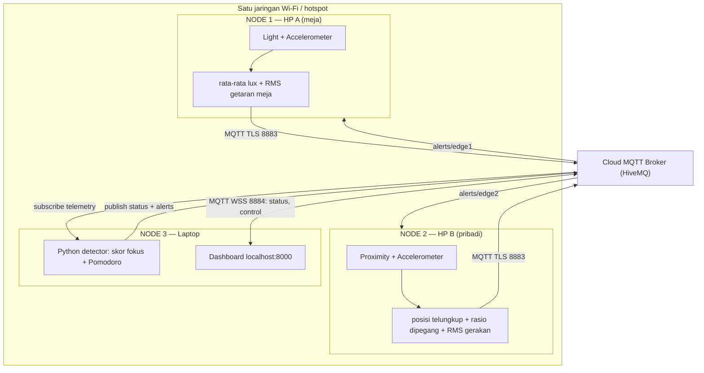

# Arsitektur & algoritma FocusDesk

Ada tiga node utama, berjalan **pada tiga perangkat fisik**: dua HP sebagai edge dan satu laptop sebagai detector/dashboard.



## Peran node

| Node | Perangkat | Input | Processing | Output |
|---|---|---|---|---|
| Edge 1 | HP A (meja) | Light + accelerometer | Rata-rata lux, RMS getaran meja | Telemetry MQTT; suara saat alert |
| Edge 2 | HP B (pribadi) | Proximity + accelerometer | Posisi telungkup, rasio dipegang, RMS gerakan | Telemetry MQTT; getar + notifikasi saat alert |
| Detector | Laptop | Telemetry + control | Skor fokus, status, Pomodoro | Status (tiap detik) dan alerts |
| Dashboard | Browser laptop | Status + alerts | Visualisasi | START / PAUSE / STOP |
| Broker | Cloud | Publish MQTT | Routing topic | Pesan ke subscriber |

## Data processing di edge

Setiap window berisi 6 sampel sensor (±1–3 detik). Yang dikirim ke MQTT hanya hasil olahannya, bukan data mentah.

**HP A (meja)**

1. **Rata-rata cahaya:** `lux_avg = rata-rata(lux)`
2. **RMS getaran meja:**
   ```
   m_i      = √(x_i² + y_i² + z_i²)
   desk_rms = √(rata-rata (m_i − rata-rata(m))²)
   ```
   Dikurangi rata-rata window (bukan 9,81) supaya selisih kalibrasi tiap HP tidak terbaca sebagai getaran.

**HP B (pribadi)**

3. **Posisi telungkup:** sebuah sampel dianggap tertelungkup jika `proximity < 3 cm` **dan** `z ≤ −7 m/s²` (layar menghadap meja). Menggabungkan dua sensor mencegah salah deteksi, misalnya tangan menutupi sensor proximity saat layar menghadap ke atas.
   `held_ratio = jumlah sampel tidak telungkup / jumlah sampel`
4. **RMS gerakan HP:** rumus sama dengan nomor 2, menunjukkan seberapa aktif HP sedang dipakai.

## Algoritma di laptop

### Skor fokus (0–100)

Dihitung setiap detik, lalu dirata-rata selama 60 detik terakhir:

```
meja_aktif  = 1 jika ada window dengan desk_rms ≥ DESK_ACTIVE_RMS dalam 15 detik terakhir, selain itu 0
skor_cahaya = 1 jika lux ideal (LUX_LOW–LUX_HIGH), 0,5 jika kurang/silau
skor = 100 × (0,45 × (1 − held_ratio) + 0,35 × meja_aktif + 0,20 × skor_cahaya)
```

Accelerometer HP murah punya noise yang besar, sehingga rata-rata getaran saat menulis hampir sama dengan meja diam. Menulis tetap menghasilkan lonjakan sesaat di atas noise. Karena itu `DESK_ACTIVE_RMS` dipasang tepat di atas nilai tertinggi meja diam (`python -m scripts.kalibrasi_meja`), dan meja dianggap aktif selama lonjakan terakhir belum lewat 15 detik.

### Status (prioritas dari atas)

| Prioritas | Kondisi | Status | Alert |
|---|---|---|---|
| 1 | Data salah satu HP > 15 detik tidak masuk | `MENUNGGU` | – |
| 2 | `held_ratio ≥ 0,5` | `TERDISTRAKSI` | HP B getar, maksimal tiap 15 detik |
| 3 | Lux tidak ideal ≥ 30 detik | `CAHAYA_KURANG` / `CAHAYA_SILAU` | HP A suara, maksimal tiap 60 detik |
| 4 | Tidak ada window dengan `desk_rms ≥ DESK_ACTIVE_RMS` selama `IDLE_SECONDS` | `MELAMUN` | HP A suara, maksimal tiap 60 detik |
| 5 | Selain itu | `FOKUS` | – |

### Pomodoro

`IDLE → (START) → FOCUS → (timer habis) → BREAK → (timer habis) → FOCUS siklus berikutnya ...`

`PAUSE` membekukan timer, `START` melanjutkan, dan `STOP` mengakhiri sesi lalu HP A membacakan ringkasan (menit fokus, berapa kali HP diambil).

### Keamanan sederhana

Seperti contoh proyek aslinya, detector menolak:
- pesan dengan timestamp lebih dari 30 detik dari jam laptop (`REJECTED_STALE`),
- pesan dengan nomor urut berulang (`REJECTED_REPLAY`),
- pesan yang topic dan `device_id`-nya tidak cocok, atau field JSON yang tidak valid.

## Topic MQTT

```text
focusdesk/<PROJECT_ID>/edge/edge1/telemetry   HP A -> broker
focusdesk/<PROJECT_ID>/edge/edge2/telemetry   HP B -> broker
focusdesk/<PROJECT_ID>/status                 laptop -> dashboard (retained, tiap detik)
focusdesk/<PROJECT_ID>/alerts/edge1           laptop -> HP A (suara)
focusdesk/<PROJECT_ID>/alerts/edge2           laptop -> HP B (getar)
focusdesk/<PROJECT_ID>/control                dashboard -> laptop (START / PAUSE / STOP)
```

## Contoh payload

```json
{"device_id": "edge1", "boot_id": "9f3c…", "sequence": 42, "sent_at_ms": 1790000000000,
 "lux_avg": 412.5, "desk_rms": 0.11}

{"device_id": "edge2", "boot_id": "a71d…", "sequence": 40, "sent_at_ms": 1790000000300,
 "face_down": true, "held_ratio": 0.0, "motion_rms": 0.02}

{"event": "DISTRACTED", "message": "Sisa 12:14. Taruh HP-nya dan lanjut belajar!", "at_ms": 1790000001000}
```

## Catatan

- Broker publik tidak punya autentikasi: siapa pun yang tahu topic bisa membaca atau mengirim pesan. Gunakan `PROJECT_ID` unik dan jangan kirim data pribadi.
- Dashboard localhost hanya bisa dibuka dari laptop yang menjalankan `detector.py`.
- Membaca buku tanpa menulis membuat meja "diam". Karena itu ambang `MELAMUN` dibuat 3 menit, dan bisa diatur lewat `IDLE_SECONDS`.
